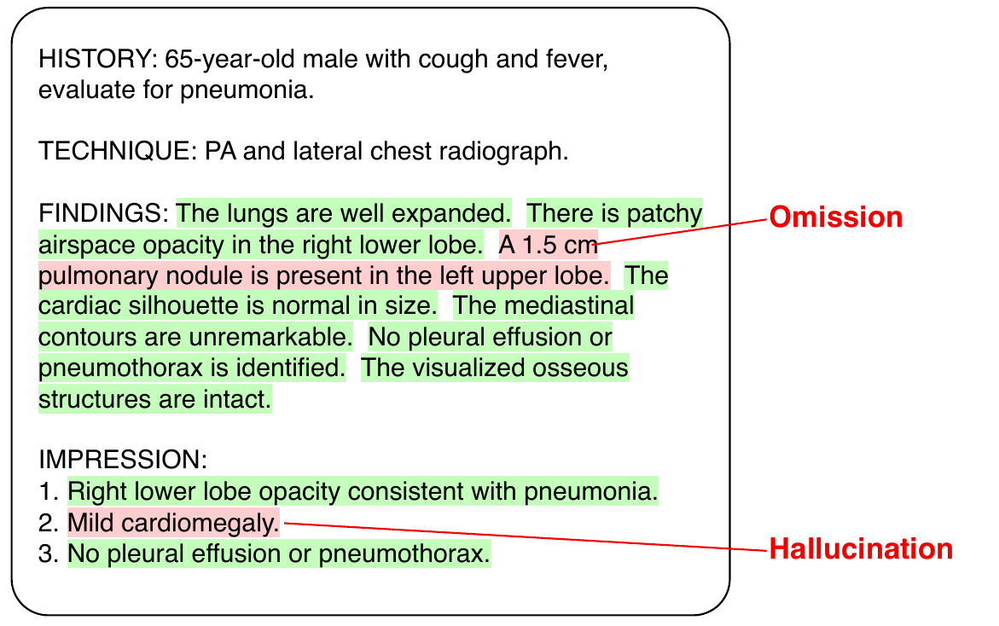

# Rad-Halo: An Expert-Annotated Benchmark for Detecting Hallucinations and Omissions in LLM-Generated Radiology Impressions

[](LICENSE)

<p align="center">
  
</p>

**Figure 1** | **The Rad-Halo task, shown on a fictional report.** Every impression sentence is labeled as a
hallucination or supported, and every findings sentence as an omission or appropriately handled. Here, "Mild
cardiomegaly" is a hallucination (the cardiac silhouette is normal in size), and the 1.5 cm pulmonary nodule is
an omission (it is missing from the impression).

## 🩻 What is Rad-Halo?

Rad-Halo is an expert-annotated benchmark for detecting hallucinations and omissions in LLM-generated
radiology impressions. It contains 300 MIMIC-IV radiology reports spanning six imaging modalities and 24
anatomical regions, with impressions kept from the original clinician-written report (50 reports) or
regenerated by one of five LLMs (250 reports). Reports were deliberately enriched for errors. Two or three
radiology residents labeled every sentence, and an attending radiologist adjudicated their disagreements. After
adjudication, 323 of 1,172 impression sentences are hallucinations and 87 of 3,704 findings sentences are
omissions.

In the paper, we find:

- Hallucination labels show substantially higher inter-annotator agreement than omission labels
  (Krippendorff's α = 0.674 vs. 0.336).
- LLM judges detect hallucinations at the level of the residents (best F1 = 0.831), while omission
  detection remains difficult (best F1 = 0.363).
- RadCheck 8B, a compact classifier trained only on synthetic sentence-deletion perturbations, approaches
  frontier LLMs on hallucinations (F1 = 0.768) and achieves the best omission F1.

This repository contains the code behind the paper: dataset construction, the detectors, and the analysis
that produces every number, table and figure.

## 📂 Data and model

| Resource | Where | Access |
|---|---|---|
| Rad-Halo: report text, sentence labels of every annotator, adjudicated labels, metadata | PhysioNet | Credentialed (PhysioNet Credentialed Health Data License) |
| RadCheck 8B weights (LoRA adapter on Qwen3-Embedding-8B) | PhysioNet | Credentialed |
| Code, detector predictions, analysis outputs | This repository | MIT |

Rad-Halo and RadCheck 8B are derived from MIMIC-IV-Note and are therefore distributed under the same access
terms. This repository contains no report text.

## ⚡️ Installation

Create an environment and install the extras for the parts you want to run:

```bash
conda create -n radhalo python=3.12 && conda activate radhalo
pip install -e ".[dev]"                 # level A
pip install -e ".[nlp,api,openai]"      # + segmentation, Gemini, Claude, GPT-6 Astra (levels B and C)
pip install -e ".[local,train,medval]"  # + open-weights models, RadCheck training, MedVAL
pip install -e ".[vllm]"                # Ministral 3B generator only (Linux + CUDA)
pip install https://s3-us-west-2.amazonaws.com/ai2-s2-scispacy/releases/v0.5.4/en_core_sci_sm-0.5.4.tar.gz
cp .env.example .env                    # paths and API credentials
```

The data are not included:
- **Rad-Halo** — download from PhysioNet and point `RADHALO_DATA` to the directory containing
  `rad_halo.json` (default `data/rad-halo/`). The same directory contains `attribution_examples.yaml`.
- **MIMIC-IV-Note v2.2** (level C) — [physionet.org/content/mimic-iv-note/2.2](https://physionet.org/content/mimic-iv-note/2.2/);
  set `MIMIC_NOTE_DIR` to the directory containing `note/radiology.csv`.

MIMIC-derived data may only be processed with services that meet PhysioNet's requirements for credentialed
data (see [PhysioNet's guidance on LLM use](https://physionet.org/news/post/llm-responsible-use/)).

## 🚀 Reproducing the paper

The code reproduces the paper at three levels. Level A needs only the Rad-Halo release.

| Level | Needs | Reproduces |
|---|---|---|
| **A. Analysis** | Rad-Halo from PhysioNet; CPU, ~1 min | Every number, table and figure in the paper's results |
| **B. Detection** | Rad-Halo; Vertex AI and OpenAI API access, or a GPU | The detector predictions in `predictions/` |
| **C. Construction and training** | MIMIC-IV-Note v2.2; Vertex AI and Anthropic API access; a GPU | Report selection, impression generation and MedVAL grading, prompt selection, synthetic training data, RadCheck training |

The annotation pipeline (Label Studio task preparation, aggregation, adjudication) is in
[`annotation/`](annotation/README.md). It documents how the labels were produced; rerunning it requires the
private annotation exports.

### A. Analysis

With the Rad-Halo release in place, one command recomputes every number, table and figure in the paper's
results on a CPU in about a minute:

```bash
make analysis        # statistics, agreement, detector metrics, tables, figures
make test            # unit tests
```

Inputs are the PhysioNet release, the detector predictions in [`predictions/`](predictions/README.md) and
the small text-free files in [`derived/`](derived/README.md). Outputs go to `results/`; the committed copy
lets you check your run with `git diff results/`.

| Paper | Script (`scripts/analysis/`) | Output (`results/`) |
|---|---|---|
| Sec. 5.1, Tables 1–2 (error prevalence) | `dataset_statistics.py` | `csv/error_rates_*.csv`, `csv/modality_anatomy_counts.csv` |
| Sec. 5.1 risk trend (Cochran-Armitage) | `dataset_statistics.py` | `csv/risk_trend.csv` |
| App. B.3 (pre-highlighting), Tables 4–5 (adjudication), Table 9 (per-annotator rates) | `dataset_statistics.py` | `csv/prehighlight_coverage.csv`, `csv/adjudication_summary.csv`, `csv/adjudicator_agreement.csv`, `csv/annotator_error_rates.csv` |
| Sec. 5.2, Table 8 (agreement) | `agreement.py` | `csv/agreement_*.csv` |
| Sec. 5.3, Table 11 (detector metrics), App. E.5 (self-evaluation check) | `detector_metrics.py` | `csv/detector_metrics.csv`, `csv/judge_flags_by_source.csv` |
| All numbers quoted in the text and all result tables | `make_tables.py` | `values.tex`, `tables/*.tex` |
| Fig. 3 (detector F1 vs. agreement) | `make_figures.py` | `figures/detector_performance.pdf` |
| Fig. 4 (risk-grade distribution, App. A.7) | `make_figures.py` | `figures/risk_grade_distribution.pdf` |

Confidence intervals use a report-level bootstrap with 1,000 resamples (seed 0). RadCheck's threshold is
the F1-optimal threshold on the evaluated sentences, re-optimized in every bootstrap replicate.

### B. Detection

The detector predictions used in the paper are committed in [`predictions/`](predictions/README.md). To
rerun a detector on Rad-Halo:

```bash
# LLM-as-judge; <judge> is a file in configs/judges/ (e.g. gemini-3.1-pro_low, claude-opus-5.5_max, qwen3-8b)
python scripts/detection/run_llm_judge.py judge=<judge>
python scripts/detection/run_llm_judge.py judge=<judge> max_reports=10 out_dir=outputs/pilot   # pilot run

# RadCheck 8B (GPU)
python scripts/detection/run_radcheck.py --checkpoint <radcheck-checkpoint-dir>
```

Each frontier model is evaluated at its lowest and highest available reasoning setting; the exact parameters
(thinking level, effort, output limit) are in `configs/judges/`. Each configuration was run once.

| Judges | Access |
|---|---|
| Gemini 2.5 Flash, Gemini 3.1 Pro | Vertex AI (`google-genai`) |
| Claude Opus 5.5 | Vertex AI (`AnthropicVertex`), structured JSON output |
| GPT-6 Astra | OpenAI Responses API, strict JSON schema, `store=false` |
| Qwen 3 8B | local (Hugging Face transformers, GPU) |

Vertex AI uses Application Default Credentials (`gcloud auth application-default login`) with `GCP_PROJECT_ID`
and `GCP_LOCATION=global` in `.env`. GPT-6 Astra needs `OPENAI_API_KEY` of a zero-data-retention project. The
project `.env` takes precedence over variables set in the shell.

Predictions are written as `outputs/detection/<judge>.jsonl` in the format of `predictions/`, the raw responses
to `<judge>.raw.jsonl` and the token usage of every request to `<judge>.usage.jsonl`. Runs resume where they
stopped. The judge prompt is `prompts/llm_judge.yaml`, the RadCheck input template `prompts/radcheck.txt`.

### C. Construction and training

Building Rad-Halo from MIMIC-IV-Note and training RadCheck 8B is described step by step in
[`docs/construction.md`](docs/construction.md): report eligibility and segmentation, prompt selection,
impression generation and MedVAL grading, synthetic training data, and RadCheck training.

## 🏗️ Repository structure

```
src/radhalo/       library: data loading and segmentation, LLM backends, detection, generation,
                   synthetic data, training, evaluation, LaTeX/figure output
scripts/           analysis/ (level A), detection/ (level B), construction/ (level C)
configs/           judge, generator, generation, detection and training configs (Hydra)
prompts/           prompt templates (no MIMIC text)
predictions/       detector outputs on Rad-Halo (scores only)
derived/           text-free inputs derived from restricted data
results/           analysis outputs used in the paper
annotation/        annotation pipeline
docs/              construction and training walkthrough (level C)
assets/            README figure
tools/             leak check run in pre-commit and CI
```

## 📎 Citation

If you use Rad-Halo, RadCheck 8B or this code, please cite:

```bibtex
@misc{gaus2026radhalo,
  title  = {Rad-Halo: An Expert-Annotated Benchmark for Detecting Hallucinations and Omissions in {LLM}-Generated Radiology Impressions},
  author = {Gaus, Richard and Aali, Asad and Polacin, Malgorzata and Paschali, Magdalini and Hein, Dennis and Lopez, Ivan and Rajabalifardi, Kamyar and Chang, Ken and Kim, Julie and Ma, Liliana and Qian, Calvin and Langlotz, Curtis and Daneshjou, Roxana and Bluethgen, Christian and Chaudhari, Akshay S.},
  year   = {2026},
  note   = {Under review}
}
```

GitHub's "Cite this repository" button gives the same reference ([`CITATION.cff`](CITATION.cff)).

## ⚖️ License

Code: MIT ([`LICENSE`](LICENSE)). Rad-Halo and MIMIC-IV-Note are subject to their PhysioNet licenses.
